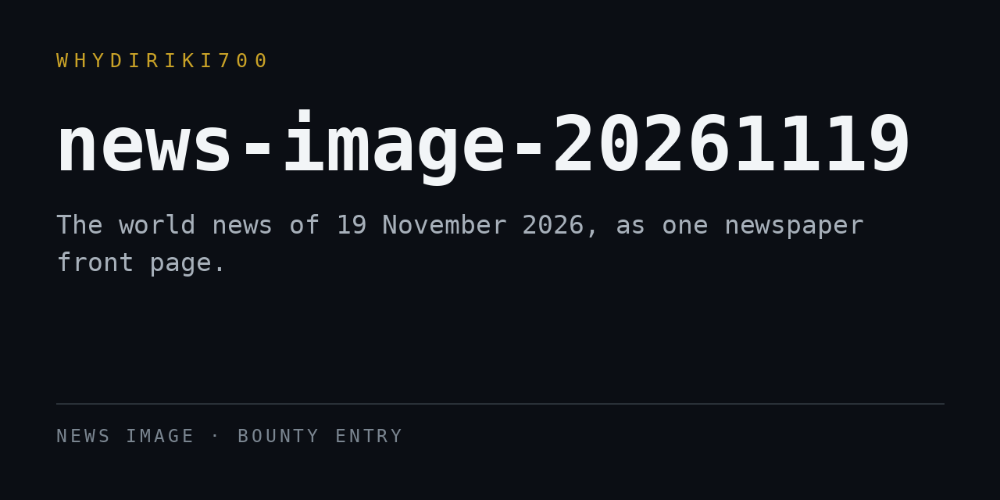

# The World in One Image: Thursday 19 November 2026

One image that carries a whole day of world news: Thursday, 19 November 2026.

The front page leads with the International Court of Justice ruling that
Myanmar committed genocide against the Rohingya, the court's first such
finding against a state. Around it: Wall Street's fifth straight slide as
Anthropic's record debut fails to calm the AI sell-off, the Trump-Xi-Putin
summit in Shenzhen closing with a peace declaration, Ukraine's third strike
on the Crimean Bridge in four days, the US Senate rejecting an Iran
war-powers resolution 51-48, Denmark's unanimous Greenland defence vote,
the COP31 fossil fuel fight, and a strip of the day's other headlines,
from North Korea's uranium expansion to Fiji's El Niño disaster.

## How it runs

`main.ts` is the entrypoint. It reads the poster stored beside it as
`entry.png`, checks that the file is a real PNG or JPEG and within the
1 MiB cap, publishes it to the output folder, and verifies the published
copy by SHA-256 so the judged image is exactly the composed front page.

## Credit

Built for the make.fun news-image bounty of 19 November 2026.
Referral: https://make.fun/r/vwpycztt
